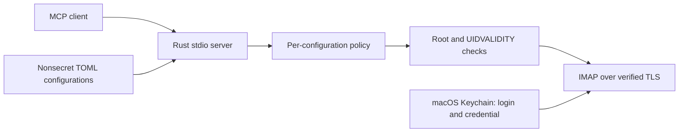

# Design

The server connects local MCP clients to explicitly configured IMAP roots.

[Access and operations](access.md) owns the `policy`, `folder`, and `message`
capabilities. [Authentication and configurations](authentication.md) owns `auth`
and `config`, and the authentication chapter also owns `oauth`. Mail content is untrusted data. Tool instructions never grant
additional access. The transport is stdio; operational output goes to stderr.
